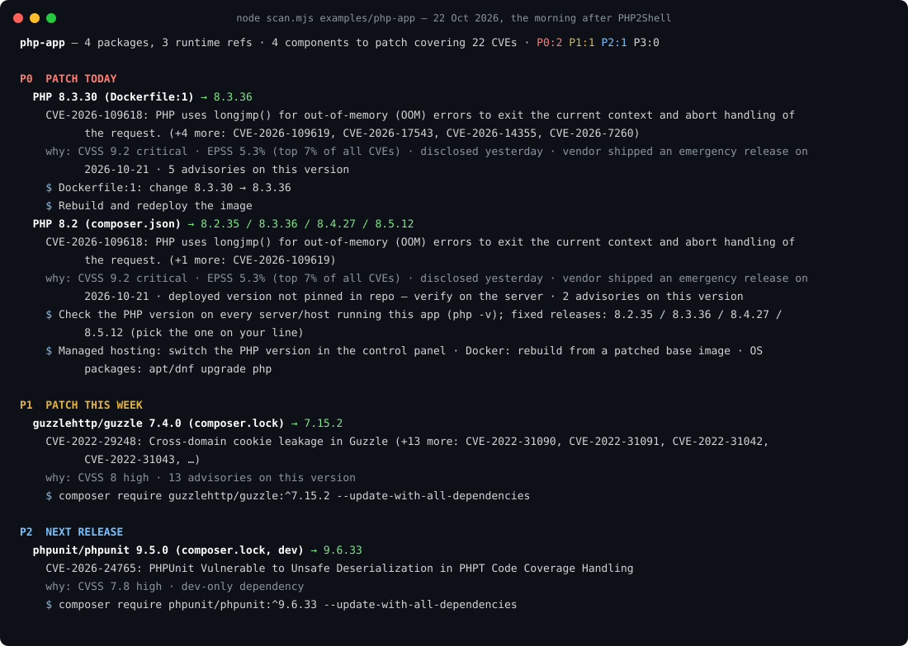

<p align="center"></p>

# patchhero

**When a vulnerability gets traction, patch now.**

A Claude Code plugin and zero-dependency scanner that finds the vulnerabilities in your project that matter *today* (not the 400 you can ignore), tells you exactly what to change, and patches them with you. It alerts the moment you open a project, runs on a schedule in GitHub Actions, and explains every priority in plain words for people who never had a security background.

<p align="center"></p>

That is the real output for [`examples/php-app`](examples/php-app) on 22 October 2026, the morning after [PHP2Shell](https://www.cisa.gov/news-events/alerts/2026/10/21/critical-vulnerabilities-php-require-immediate-patching) (CVE-2026-109618 and CVE-2026-109619) was disclosed. It was not yet in CISA's exploited list and its EPSS score was 5%, so tools that rely on one signal called it "medium". patchhero called it P0, because it combines five signals: CVSS, CISA KEV, EPSS, disclosure age, and whether the vendor just shipped an emergency release.

The names on the banner are real: Heartbleed, Shellshock, WannaCry, Log4Shell, the xz backdoor, PHP2Shell, and the October 2026 attack that heated the fridges of hundreds of French supermarkets to 50 °C through refrigeration controllers running firmware nobody updated. Different bugs, one pattern: the fix existed, and the software kept running without it. patchhero exists so that the next one is caught the morning it breaks, in every project you open, not months later from a customer.

## What you get

1. **An alert when you open the project.** A SessionStart hook scans the project (cached six hours, read-only, silent when nothing is urgent) and Claude starts the session by telling you what to patch today.
2. **A skill that patches with you.** `/patchhero` runs the scan, explains the P0/P1 items in plain words, asks before changing anything, applies the exact upgrade per ecosystem, re-scans to verify, runs your tests, and prepares the commit or PR.
3. **A siren for what is spreading right now.** Every scan also reads the last 48 hours of CISA alerts, new entries in CISA's exploited-in-the-wild list, the Hacker News front page and Google News, clusters them by product, and says whether each story touches this project, the software everyone runs (your OS, CPU, OpenSSL, Docker, browser), or is simply too big to ignore. While something is spreading, the session-start check runs hourly.
4. **A scheduled scan for every repo.** One workflow file: every six hours, a report in the job summary, an issue opened or updated when something is urgent, a red check on P0. Optionally Claude opens the fix PR.

## Install

As a Claude Code plugin (recommended, includes the session-start alert):

```
/plugin marketplace add Mojizhasan/patchhero
/plugin install patchhero@patchhero
```

Or from your shell: `claude plugin install patchhero --marketplace Mojizhasan/patchhero`.

As a plain skill for any agent that reads `SKILL.md` folders: copy `skills/patchhero` into `~/.claude/skills/` (or your project's `.claude/skills/`). You get `/patchhero` but not the hook; the skill can add one to your settings when you ask.

As a command-line tool (Node 18+, no install):

```bash
npx --yes github:Mojizhasan/patchhero            # scan the current directory
node skills/patchhero/scripts/scan.mjs ~/projects --all   # one table across every project
```

## Use

| You say | What happens |
| --- | --- |
| *open a project* | the hook prints a `<patchhero-alert>` block if anything is P0/P1; Claude tells you first thing |
| `/patchhero` | full scan, plain-language summary, patch after you confirm, re-scan, tests, commit |
| "is my project affected by the PHP bug?" | scan, look up the CVE, compare versions, answer with evidence |
| "patch everything urgent" | upgrades from the top of the list down, verifies, summarises what still needs you |
| "set this up for all my repos" | copies the GitHub Actions workflow, explains the three automation layers |
| "scan all my projects" | `--all` over a folder of repositories, sorted by worst priority |
| "what is going on out there?" | `--news`: everything spreading in the last 48 hours, with what it means for you |

Scanner flags: `--json`, `--md`, `--min P1`, `--local` (check the runtimes installed on this machine too), `--all`, `--news` (show everything spreading, not only what touches this project), `--no-news`, `--offline`, `--fail-on P0` (exit code 2 for CI).

## How priority works

| Level | Meaning | Typical trigger |
| --- | --- | --- |
| **P0** | patch today | in CISA KEV, or EPSS ≥ 30%, or CVSS ≥ 9, or a fresh high-severity CVE with an emergency vendor release |
| **P1** | patch this week | CVSS 7 to 8.9, or EPSS ≥ 5% |
| any | one level more urgent | the CVE or product is spreading in the news, on Hacker News or in a CISA alert right now |
| **P2** | next release | CVSS 4 to 6.9, or a critical in a dev-only dependency |
| **P3** | backlog | the rest |

Full rules, the PHP2Shell worked example, and plain-language explanations for each reason: [`skills/patchhero/references/priority.md`](skills/patchhero/references/priority.md).

## What it reads

| Ecosystem | Files |
| --- | --- |
| npm, pnpm, yarn | package-lock.json, npm-shrinkwrap.json, pnpm-lock.yaml, yarn.lock (v1 and berry), package.json (exact pins, `engines.node`) |
| Composer | composer.lock, composer.json (exact pins, `php` constraint, `config.platform.php`) |
| Python | requirements*.txt, poetry.lock, uv.lock, pdm.lock, Pipfile.lock, pyproject.toml (`requires-python`) |
| Go | go.mod (modules, `go`/`toolchain` directive, stdlib advisories) |
| Rust | Cargo.lock |
| Ruby | Gemfile.lock, Gemfile (`ruby`) |
| .NET | packages.lock.json, *.csproj |
| Java | pom.xml (literal versions), gradle.lockfile |
| Containers | Dockerfile*, docker-compose*.yml / compose*.yml (`php`, `node`, `python`, `ruby`, `golang`, `nginx`, `wordpress` images, vendor images like `serversideup/php`) |
| Version files | .php-version, .nvmrc, .node-version, .python-version, .ruby-version, .go-version, .tool-versions, runtime.txt |
| CI | `php-version`, `node-version`, `python-version`, `ruby-version`, `go-version` in `.github/workflows/*.yml` |
| This machine | `--local`: `php -v`, `node -v`, `python --version`, `ruby -v`, `go version`, `nginx -v` for the runtimes the project uses |

Skip directories (demo apps, vendored code, fixtures) with a `.patchhero.json` in the project root: `{ "ignore": ["examples", "test/fixtures"] }`.

## Data sources

All public, all free, no API keys:

- [OSV.dev](https://osv.dev) for package vulnerabilities (covers the GitHub Advisory Database, PyPA, RustSec, Go vulndb and more)
- [NVD](https://nvd.nist.gov) for runtime CVEs by CPE (PHP, Node.js, Python, Ruby, Go, nginx, WordPress), last 120 days
- [endoflife.date](https://endoflife.date) for the latest patch release of each runtime line and end-of-life dates
- [CISA KEV](https://www.cisa.gov/known-exploited-vulnerabilities-catalog) for vulnerabilities exploited in the wild
- [FIRST EPSS](https://www.first.org/epss/) for exploitation probability
- The siren: [CISA alerts](https://www.cisa.gov/news-events/cybersecurity-advisories), KEV entries added in the last 3 days, [Hacker News](https://hn.algolia.com/) stories with 30+ points and [Google News](https://news.google.com/) headlines from the last 48 hours, with fixed search terms

Privacy: only package names and versions are sent (to OSV.dev); everything else is downloaded as whole feeds, and the news queries are fixed strings that say nothing about your project. No telemetry, no account, no network calls from the hook when the cached result is fresh. Feed data is cached in `~/.cache/patchhero`. Set `NVD_API_KEY` if you scan many runtimes in CI and hit NVD's unauthenticated rate limit.

## Scheduled scans in GitHub Actions

Copy [`skills/patchhero/assets/patchhero.yml`](skills/patchhero/assets/patchhero.yml) to `.github/workflows/patchhero.yml`. It needs no secrets. A commented job in the same file lets [Claude Code](https://github.com/anthropics/claude-code-action) apply the patches and open the PR; that one needs an `ANTHROPIC_API_KEY` secret.

## Limitations, honestly

- No lockfile means only exactly pinned versions can be checked; the report says so.
- A constraint such as `"php": "^8.2"` does not say what is deployed. Runtime findings tell you *where* to upgrade (container, server, hosting panel, laptop); the scan cannot verify a server it cannot see. Run it with `--local` on the server if you can.
- Feeds lag disclosure by hours. For a CVE younger than a day, the skill reads the vendor advisory directly.
- Versions behind MSBuild properties, Maven parent POMs or BOMs are invisible.
- It is a prioritiser and a patcher, not a code scanner. For vulnerabilities in your own code, use a SAST tool alongside it.

## Development

```bash
npm test                                          # offline parser, scoring and grouping tests
node skills/patchhero/scripts/scan.mjs examples/php-app --local
claude plugin validate .
claude --plugin-dir .                             # load the plugin for one session
```

Layout: `skills/patchhero/` is the skill (SKILL.md, scripts, references, assets, evals); `hooks/` is the SessionStart hook; `.claude-plugin/` holds the plugin and marketplace manifests; `examples/` are deliberately vulnerable projects for demos and tests.

Contributions welcome: new lockfile formats, more runtimes (Java, .NET runtime, Deno, Bun), better fix commands, or an eval case that shows the skill doing the wrong thing.

## License

MIT
